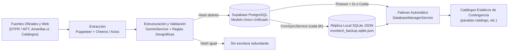

# Arquitectura de Datos, Extracción y Actualización — MoviTech

Este documento detalla de forma técnica cómo se **obtienen, validan, almacenan, consultan y actualizan** los datos de movilidad pública (microbuses, colectivos, paraderos, horarios y radiotaxis) en MoviTech, asegurando respuestas consistentes en menos de $1.5\text{ s}$ y disponibilidad ante fallos de red o de fuentes externas.

---

## 1. Arquitectura General del Flujo de Datos

---

## 2. ¿De dónde se sacan los datos? (Fuentes y Mecanismos de Extracción)

MoviTech combina **tres mecanismos complementarios** según la naturaleza de cada entidad:

### 2.1 Extracción Web Automatizada de Tarifas y Recorridos (`Puppeteer` + IA)
- **Componentes:** [`extraer-tarifas-puppeteer.ts`](file:///c:/Users/benja/Documents/GitHub/Proyecto-de-titulo/backend/src/scripts/extraer-tarifas-puppeteer.ts) (`PuppeteerExtractor`, `ExtractorTarifasService`) y [`ai-extractor.service.ts`](file:///c:/Users/benja/Documents/GitHub/Proyecto-de-titulo/backend/src/transport/extraction/ai-extractor.service.ts) (`AiExtractorService`).
- **Fuentes:** Portal DTPR / Ministerio de Transportes (`https://dtpr.mtt.gob.cl/`), información comunal de transporte de Quilpué y referencias de operadores locales (TMV / Fenur).
- **Proceso paso a paso:**
  1. `PuppeteerExtractor.fetchPageContent(url)` levanta un navegador Chromium headless (`--no-sandbox`) para renderizar contenido dinámico. Si Puppeteer no está disponible en el entorno (ej. contenedores livianos sin Chromium), degrada automáticamente a una petición HTTP ligera con `axios.get` y `User-Agent` estándar.
  2. El HTML extraído se limpia eliminando etiquetas `<script>`, `<style>` y markup innecesario, limitando el texto útil a 8.000 caracteres para optimizar latencia y tokens.
  3. `AiExtractorService.extractAndStructureWithAi(url)` envía el texto limpio a la API HTTPS de Gemini (`responseMimeType: 'application/json'`, `temperature: 0.1`) solicitando el JSON estricto con `rutas`, `paradas` y `tarifas`.
  4. **Resiliencia de modelos:** Si el modelo configurado falla por cuota o latencia, itera automáticamente sobre una lista de modelos de respaldo antes de devolver `null` y preservar los datos ya existentes.

### 2.2 Extracción de Centrales de Radio Taxi (`Cheerio` + `__NEXT_DATA__`)
- **Componente:** [`poblar-radiotaxis.ts`](file:///c:/Users/benja/Documents/GitHub/Proyecto-de-titulo/backend/src/scripts/poblar-radiotaxis.ts) (`extraerRadioTaxisWeb()`).
- **Fuente:** Directorio público de Páginas Amarillas Quilpué (`amarillas.cl`).
- **Proceso:**
  1. Descarga el HTML con `axios.get` (timeout 10 s).
  2. Parsea el DOM con `cheerio` y extrae el bloque JSON embebido `#__NEXT_DATA__` (`props.pageProps.results`).
  3. Normaliza los teléfonos chilenos a formato **E.164** (`+569...`) para habilitar discado en un toque (`<a href="tel:+56...">`) en Telegram, conservando además una versión legible (`telefono_formateado`).
  4. Excluye registros sin teléfono o fuera de la cobertura objetivo (Quilpué). Si el scraping falla o entrega lista vacía, utiliza la lista validada `CONTINGENCIA_MARGA_MARGA`.

### 2.3 Carga Inicial Curada y Validada (Seeds Idempotentes)
Para datos estructurales que requieren alta precisión (coordenadas GPS reales de paraderos en Quilpué/Villa Alemana y franjas horarias por tipo de día), los scripts `npm run db:populate*` ejecutan operaciones `UPSERT` idempotentes (`onConflict`) sobre Supabase:
- `db:populate` ([`poblar-transporte.ts`](file:///c:/Users/benja/Documents/GitHub/Proyecto-de-titulo/backend/src/scripts/poblar-transporte.ts)): puebla `medio_transporte`, `recorrido_transporte` y `horario_servicio`.
- `db:populate-horarios` ([`poblar-horarios.ts`](file:///c:/Users/benja/Documents/GitHub/Proyecto-de-titulo/backend/src/scripts/poblar-horarios.ts)): sincroniza franjas de lunes a viernes, sábados y domingos/festivos.
- `db:populate-colectivos` ([`poblar-colectivos.ts`](file:///c:/Users/benja/Documents/GitHub/Proyecto-de-titulo/backend/src/scripts/poblar-colectivos.ts)): carga líneas 1 a 5 de colectivos de Quilpué con tarifas diurna, nocturna y adulto mayor.
- `db:populate-paradas` ([`poblar-paradas.ts`](file:///c:/Users/benja/Documents/GitHub/Proyecto-de-titulo/backend/src/scripts/poblar-paradas.ts)): inserta paraderos con coordenadas WGS84 verificadas y bandera `es_punto_seguro`.

---

## 3. ¿Cómo se validan los datos antes de guardarlos?

Antes de persistir cualquier registro extraído automáticamente (`AiExtractorService.validateAndNormalizePayload`), se aplican **cuatro filtros de integridad**:

1. **Integridad de esquema:** Descarta rutas sin `idRecorrido`, `nombreRecorrido` o `callesPrincipales`.
2. **Geocerca estricta de Marga Marga (anti-alucinaciones):** Para paraderos extraídos, valida que la latitud esté en $[-33.15, -32.95]$ y la longitud en $[-71.55, -71.25]$ (zona Quilpué–Villa Alemana–Limache). En tiempo de consulta, `HaversineService.validateCoordinates()` valida además rango geográfico chileno ($[-56, -17]$ lat, $[-76, -66]$ lng) y descarta `NaN`, `Infinity` o valores nulos.
3. **Rango de tarifas válidas:** Acepta únicamente tarifas entre $\$100$ y $\$15.000$ CLP y asegura que `tarifaAdultoMayor <= tarifaGeneral`.
4. **Detección de cambios por hash (`saveIfChanged`):** Calcula un hash determinístico del payload normalizado y lo compara contra `lastExtractedHash`. Si los datos son idénticos al ciclo anterior, **omite la escritura en Supabase**, evitando desgaste innecesario de I/O y manteniendo registros limpios.

---

## 4. ¿Cómo se mantienen actualizados los datos?

### 4.1 Sincronización Periódica Automática (`CronSyncService`)
- **Componente:** [`cron-sync.service.ts`](file:///c:/Users/benja/Documents/GitHub/Proyecto-de-titulo/backend/src/transport/extraction/cron-sync.service.ts).
- **Frecuencia:** Se ejecuta automáticamente al iniciar el módulo (`OnModuleInit`) con intervalo configurable mediante `CRON_SYNC_INTERVAL_MS` (por defecto **cada 6 horas**: `21.600.000 ms`). El temporizador utiliza `.unref()` para no bloquear el apagado limpio del proceso Node.js ni de las pruebas.
- **Ciclo de actualización (`runVerificationAndSync`):**
  1. **Respaldo preventivo:** Invoca `databaseManager.syncSupabaseToSqlite()`, consultando en paralelo (`Promise.allSettled`) las tablas `recorrido_transporte`, `parada`, `colectivo`, `servicio_radiotaxi` y `horario_servicio` y persistiendo la instantánea en `backend/movitech_backup.sqlite.json`.
  2. **Verificación de fuente externa:** Ejecuta `aiExtractor.extractAndStructureWithAi(sourceUrl)` y, si hay novedades válidas, ejecuta `aiExtractor.saveIfChanged(structured)` para actualizar Supabase mediante `upsert`.
  3. **Tolerancia a fallos:** Ante cualquier error de red o timeout de la fuente externa, captura la excepción, registra el evento en logs y **conserva intactos los últimos datos válidos**, sin interrumpir el bot de Telegram.

### 4.2 Alta Disponibilidad en Tiempo de Consulta (`DatabaseManagerService`)
Cuando un adulto mayor consulta al bot de Telegram, el sistema nunca depende de una llamada lenta a internet externo:
1. **Nivel 1 (Primario — Supabase):** Consulta directa a PostgreSQL con **timeout estricto de $1.2\text{ s}$ – $2.0\text{ s}$** e índices B-Tree / espaciales (`idx_parada_lat_lng`, `idx_medio_hospital`). Si responde bien, refresca la copia en memoria/disco.
2. **Nivel 2 (Failover — Réplica local SQLite JSON):** Si Supabase falla o supera el timeout, `DatabaseManagerService.queryWithFailover()` conmuta instantáneamente (`< 5 ms`) a `movitech_backup.sqlite.json`.
3. **Nivel 3 (Contingencia estática en memoria):** Si la réplica local aún no ha sido sincronizada, cada servicio (`RutasService`, `ColectivosService`, `TaxisService`, `HaversineService`) cuenta con su catálogo validado en código (`CATALOGO_PARADAS_MARGA_MARGA`, etc.) para garantizar $0\%$ de respuestas vacías o errores 500 al usuario final.
