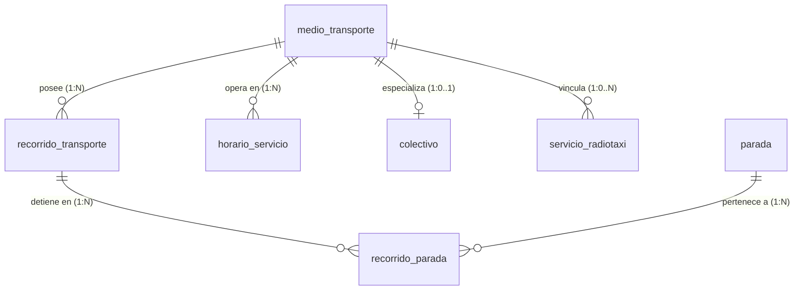

# Diccionario de Datos — MoviTech (Modelo Único Unificado)

**Motor primario:** PostgreSQL 15+ (Supabase)  
**Motor de contingencia local:** Réplica estructurada JSON/SQLite (`backend/movitech_backup.sqlite.json`)  
**Definición DDL canónica:** [`modelo_unico_movitech.sql`](file:///c:/Users/benja/Documents/GitHub/Proyecto-de-titulo/backend/src/scripts/modelo_unico_movitech.sql)  
**Contratos TypeScript canónicos:** [`unified-model.types.ts`](file:///c:/Users/benja/Documents/GitHub/Proyecto-de-titulo/backend/src/transport/database/unified-model.types.ts)

---

## 1. Diagrama Entidad-Relación Unificado

> **Criterio de unificación:** Todas las modalidades (`Microbús`, `Colectivo`, `Radio Taxi`) convergen en la entidad maestra `medio_transporte`, eliminando modelos desconectados. Las tablas operativas (`recorrido_transporte`, `colectivo`, `horario_servicio`, `servicio_radiotaxi`) referencian su `id_transporte` mediante llave foránea, mientras que la georreferenciación de paraderos se resuelve mediante `parada` y la tabla asociativa `recorrido_parada`.

---

## 2. Detalle de Tablas y Atributos

### 2.1 Tabla `public.medio_transporte` (Entidad Maestra)

| Columna | Tipo SQL | Nulo | PK / FK | Restricciones / Dominio | Valor por defecto | Descripción |
| :--- | :--- | :---: | :---: | :--- | :--- | :--- |
| `id_transporte` | `VARCHAR(50)` | NO | **PK** | Formato `TRANS-<COD>` | — | Identificador único del servicio o línea (ej. `TRANS-111`, `TRANS-C02`, `TRANS-COL-04`). |
| `nombre_linea` | `VARCHAR(100)` | NO | — | No vacío | — | Nombre legible de la línea o servicio mostrado al usuario (ej. `Línea 111`). |
| `tipo_transporte` | `VARCHAR(30)` | NO | — | `CHECK IN ('Microbús', 'Colectivo', 'Radio Taxi')` | — | Categoría modal del servicio. |
| `empresa_operadora` | `VARCHAR(150)` | NO | — | — | `'TMV / Marga Marga'` | Operador o concesionaria responsable (ej. `Fenur S.A.`, `TMV Marga Marga`). |
| `tarifa_general` | `INTEGER` | NO | — | `>= 0` (CLP) | `450` | Tarifa adulto general en pesos chilenos. |
| `tarifa_adulto_mayor` | `INTEGER` | NO | — | `>= 0` (CLP) | `150` | Tarifa preferencial adulto mayor en pesos chilenos. |
| `tarifa_escolar` | `INTEGER` | NO | — | `>= 0` (CLP) | `150` | Tarifa estudiante vigente en pesos chilenos. |
| `accesible_silla_ruedas` | `BOOLEAN` | NO | — | `{true, false}` | `true` | Indica si el servicio dispone de acceso universal o piso bajo. |
| `tipo_prestacion` | `VARCHAR(150)` | NO | — | — | `'Rampa de acceso y asientos preferenciales'` | Detalle de prestaciones de accesibilidad para adultos mayores. |
| `frecuencia_estimada` | `VARCHAR(50)` | NO | — | — | `'Cada 10-15 min'` | Intervalo promedio de paso en hora hábil. |
| `pasa_hospital_quilpue` | `BOOLEAN` | NO | — | `{true, false}` | `false` | Bandera de negocio (HU2): `true` si la línea llega al Hospital de Quilpué. |
| `activo` | `BOOLEAN` | NO | — | `{true, false}` | `true` | Borrado lógico; `false` excluye la línea de las consultas del bot. |
| `created_at` | `TIMESTAMPTZ` | NO | — | ISO-8601 UTC | `NOW()` | Fecha de creación del registro. |
| `updated_at` | `TIMESTAMPTZ` | NO | — | ISO-8601 UTC | `NOW()` | Fecha de última actualización. |

**Índices:** `idx_medio_tipo (tipo_transporte)`, `idx_medio_hospital (pasa_hospital_quilpue) WHERE pasa_hospital_quilpue = true`, `idx_medio_activo (activo)`.

---

### 2.2 Tabla `public.recorrido_transporte`

| Columna | Tipo SQL | Nulo | PK / FK | Restricciones / Dominio | Valor por defecto | Descripción |
| :--- | :--- | :---: | :---: | :--- | :--- | :--- |
| `id_recorrido` | `VARCHAR(50)` | NO | **PK** | Formato `REC-<COD>` | — | Identificador único del trazado. |
| `id_transporte` | `VARCHAR(50)` | NO | **FK** | Ref. `medio_transporte(id_transporte) ON DELETE CASCADE` | — | Línea de transporte a la que pertenece el recorrido. |
| `nombre_recorrido` | `VARCHAR(150)` | NO | — | No vacío | — | Resumen origen–destino (ej. `Los Pinos - Hospital - Playa Ancha`). |
| `sentido` | `VARCHAR(40)` | NO | — | `'Ida'`, `'Retorno'`, `'Ida y Retorno'` | `'Ida y Retorno'` | Dirección de circulación del trazado. |
| `calles_principales` | `TEXT` | NO | — | No vacío | — | Ejes viales, hitos y palabras clave de cobertura usados por el filtro de rutas. |
| `frecuencia` | `VARCHAR(50)` | NO | — | — | `'Regular'` | Descriptor cualitativo de frecuencia (`Regular`, `Frecuencia alta`, `Frecuencia continua`). |
| `pasa_hospital_quilpue` | `BOOLEAN` | NO | — | `{true, false}` | `false` | Indica si este trazado pasa por el Hospital de Quilpué. |
| `activo` | `BOOLEAN` | NO | — | `{true, false}` | `true` | Estado operativo del recorrido. |
| `created_at` / `updated_at` | `TIMESTAMPTZ` | NO | — | ISO-8601 UTC | `NOW()` | Marcas temporales de auditoría. |

**Índices:** `idx_recorrido_transporte_fk (id_transporte)`, `idx_recorrido_hospital (pasa_hospital_quilpue)`.

---

### 2.3 Tabla `public.colectivo`

| Columna | Tipo SQL | Nulo | PK / FK | Restricciones / Dominio | Valor por defecto | Descripción |
| :--- | :--- | :---: | :---: | :--- | :--- | :--- |
| `id_colectivo` | `VARCHAR(50)` | NO | **PK** | Formato `COL-QLP-<NN>` | — | Identificador único de la línea de taxi colectivo. |
| `id_transporte` | `VARCHAR(50)` | NO | **FK** | Ref. `medio_transporte(id_transporte) ON DELETE CASCADE` | — | Enlace con el catálogo maestro `medio_transporte`. |
| `numero_linea` | `VARCHAR(50)` | NO | — | Ej. `Línea 1`, `Línea 4` | — | Numeración pública del letrero del colectivo. |
| `nombre_linea` | `VARCHAR(150)` | NO | — | — | — | Nombre completo del recorrido (ej. `Línea 4 Hospital de Quilpué - Valencia`). |
| `comuna` | `VARCHAR(100)` | NO | — | — | `'Quilpué'` | Comuna principal de operación. |
| `origen` / `destino` | `VARCHAR(150)` | NO | — | — | — | Terminales o puntos extremos del recorrido. |
| `trazado_ida` / `trazado_regreso` | `TEXT` | NO | — | — | — | Calles de circulación en ambos sentidos. |
| `frecuencia_minutos` | `INTEGER` | NO | — | `> 0` | `5` | Intervalo estimado de salida en minutos. |
| `horario_inicio` / `horario_termino` | `VARCHAR(5)` | NO | — | Formato `HH:mm` | `'06:00'` / `'22:30'` | Rango horario habitual de servicio. |
| `tarifa_diurna` | `INTEGER` | NO | — | `>= 0` (CLP) | `850` | Tarifa diurna general. |
| `tarifa_nocturna` | `INTEGER` | NO | — | `>= 0` (CLP) | `1100` | Tarifa nocturna / festivos. |
| `tarifa_adulto_mayor` | `INTEGER` | NO | — | `>= 0` (CLP) | `600` | Tarifa preferencial adulto mayor. |
| `accesible_adulto_mayor` | `BOOLEAN` | NO | — | `{true, false}` | `true` | Disponibilidad de asistencia/detención preferencial. |
| `paraderos_principales` | `TEXT` | SÍ | — | Lista separada por comas | `NULL` | Puntos de detención habituales. |
| `pasa_hospital_quilpue` | `BOOLEAN` | NO | — | `{true, false}` | `false` | Indica si la línea de colectivo llega al Hospital de Quilpué. |
| `activo` | `BOOLEAN` | NO | — | `{true, false}` | `true` | Estado operativo del servicio. |

**Índices:** `idx_colectivo_id_transporte`, `idx_colectivo_comuna`, `idx_colectivo_numero_linea`, `idx_colectivo_activo`.

---

### 2.4 Tabla `public.horario_servicio`

| Columna | Tipo SQL | Nulo | PK / FK | Restricciones / Dominio | Valor por defecto | Descripción |
| :--- | :--- | :---: | :---: | :--- | :--- | :--- |
| `id_horario` | `VARCHAR(50)` | NO | **PK** | Formato `HOR-<LINEA>-<DIA>` | — | Identificador único de franja horaria. |
| `id_transporte` | `VARCHAR(50)` | NO | **FK** | Ref. `medio_transporte(id_transporte) ON DELETE CASCADE` | — | Línea asociada al itinerario. |
| `tipo_dia` | `VARCHAR(20)` | NO | — | `CHECK IN ('semana', 'sabado', 'domingo')` | — | Clasificación del día para comparación horaria en tiempo real. |
| `dias` | `VARCHAR(50)` | NO | — | Ej. `Lunes a Viernes` | — | Etiqueta legible presentada al adulto mayor. |
| `hora_inicio` | `VARCHAR(5)` | NO | — | Formato `HH:mm` (24 h) | — | Hora de primera salida. |
| `hora_termino` | `VARCHAR(5)` | NO | — | Formato `HH:mm` (24 h) | — | Hora de última salida. |
| `activo` | `BOOLEAN` | NO | — | `{true, false}` | `true` | Habilitación de la franja. |

**Índices:** `idx_horario_transporte (id_transporte)`, `idx_horario_tipo_dia (tipo_dia)`.

---

### 2.5 Tabla `public.parada`

| Columna | Tipo SQL | Nulo | PK / FK | Restricciones / Dominio | Valor por defecto | Descripción |
| :--- | :--- | :---: | :---: | :--- | :--- | :--- |
| `id_parada` | `VARCHAR(50)` | NO | **PK** | Formato `PAR-<COM>-<NN>` | — | Identificador único del paradero. |
| `codigo_parada` | `VARCHAR(30)` | SÍ | — | Código DTPR / interno | `NULL` | Código corto de referencia (ej. `PA-HOSP-01`). |
| `nombre` | `VARCHAR(150)` | NO | — | No vacío | — | Nombre descriptivo del paradero o hito cercano. |
| `direccion` | `VARCHAR(255)` | NO | — | No vacío | — | Intersección o numeración referencial. |
| `latitud` | `NUMERIC(10,7)` | NO | — | `BETWEEN -56.0 AND -17.0` | — | Coordenada WGS84 (latitud sur en Chile). |
| `longitud` | `NUMERIC(10,7)` | NO | — | `BETWEEN -76.0 AND -66.0` | — | Coordenada WGS84 (longitud oeste en Chile). |
| `comuna` | `VARCHAR(50)` | NO | — | — | `'Quilpué'` | Comuna donde se ubica el paradero. |
| `es_punto_seguro` | `BOOLEAN` | NO | — | `{true, false}` | `true` | Marca si cuenta con iluminación/vereda segura para adulto mayor y espera de radiotaxi. |
| `tipo_parada` | `VARCHAR(60)` | NO | — | — | `'Microbús y Colectivo'` | Modalidades que operan en el paradero. |
| `lineas_asociadas` | `TEXT` | SÍ | — | Lista legible de líneas | `NULL` | Resumen textual de líneas que se detienen aquí (complementa `recorrido_parada`). |
| `activo` | `BOOLEAN` | NO | — | `{true, false}` | `true` | Indica si el paradero está vigente. |

**Índices:** `idx_parada_lat_lng (latitud, longitud)` (prefiltro bounding box espacial), `idx_parada_comuna (comuna)`, `idx_parada_punto_seguro (es_punto_seguro)`, `idx_parada_activa (activo)`.

---

### 2.6 Tabla `public.recorrido_parada`

| Columna | Tipo SQL | Nulo | PK / FK | Restricciones / Dominio | Valor por defecto | Descripción |
| :--- | :--- | :---: | :---: | :--- | :--- | :--- |
| `id_recorrido_parada` | `VARCHAR(50)` | NO | **PK** | Formato `RP-<NN>` | — | Identificador de la relación parada–recorrido. |
| `id_recorrido` | `VARCHAR(50)` | NO | **FK** | Ref. `recorrido_transporte(id_recorrido) ON DELETE CASCADE` | — | Recorrido que pasa por el paradero. |
| `id_parada` | `VARCHAR(50)` | NO | **FK** | Ref. `parada(id_parada) ON DELETE CASCADE` | — | Paradero incluido en el recorrido. |
| `orden` | `INTEGER` | NO | — | `> 0`, `UNIQUE(id_recorrido, id_parada, orden)` | `1` | Secuencia ordenada del paradero dentro del trazado. |

---

### 2.7 Tabla `public.servicio_radiotaxi`

| Columna | Tipo SQL | Nulo | PK / FK | Restricciones / Dominio | Valor por defecto | Descripción |
| :--- | :--- | :---: | :---: | :--- | :--- | :--- |
| `id_radiotaxi` | `VARCHAR(50)` | NO | **PK** | Formato `TAXI-<COM>-<NN>` | — | Identificador único de la central. |
| `id_transporte` | `VARCHAR(50)` | SÍ | **FK** | Ref. `medio_transporte(id_transporte) ON DELETE SET NULL` | `NULL` | Enlace opcional con el catálogo maestro. |
| `nombre_central` | `VARCHAR(150)` | NO | — | No vacío | — | Nombre comercial de la central autorizada. |
| `telefono` | `VARCHAR(30)` | NO | — | Formato E.164 (`+56...`) | — | Teléfono para enlace directo `tel:` en Telegram. |
| `telefono_formateado` | `VARCHAR(50)` | NO | — | Legible (ej. `(+56 9) 8979 5644`) | — | Formato visual amigable para lectura del adulto mayor. |
| `direccion_base` | `VARCHAR(255)` | NO | — | — | — | Dirección física de la base de operaciones. |
| `comuna` | `VARCHAR(80)` | NO | — | — | `'Quilpué'` | Comuna de cobertura principal. |
| `tarifa_base_estimada` | `VARCHAR(50)` | NO | — | — | `'$2.500 - $3.200'` | Rango referencial informado antes de llamar. |
| `tarifa_minima` / `tarifa_por_km` / `recargo_nocturno` | `INTEGER` | NO | — | `>= 0` (CLP) | `2500` / `800` / `500` | Parámetros numéricos para estimación de costo. |
| `maletero_silla_ruedas` | `BOOLEAN` | NO | — | `{true, false}` | `true` | Capacidad para trasladar ayudas técnicas (burrito/silla plegable). |
| `horario_atencion` | `VARCHAR(50)` | NO | — | — | `'24 Horas'` | Disponibilidad horaria de despacho. |
| `autorizada` | `BOOLEAN` | NO | — | `{true, false}` | `true` | Central verificada/autorizada para adultos mayores. |
| `activo` | `BOOLEAN` | NO | — | `{true, false}` | `true` | Vigencia en el directorio. |

---

### 2.8 Tabla `public.registro_actualizacion_datos` (Auditoría de Extracción)

| Columna | Tipo SQL | Nulo | PK / FK | Restricciones / Dominio | Valor por defecto | Descripción |
| :--- | :--- | :---: | :---: | :--- | :--- | :--- |
| `id_actualizacion` | `VARCHAR(50)` | NO | **PK** | UUID / `SYNC-<TIMESTAMP>` | — | Identificador del ciclo de extracción o sincronización. |
| `fuente_url` | `VARCHAR(255)` | NO | — | URL válida o `'seed_local'` | — | Origen de los datos (DTPR, Amarillas.cl, Moovit, etc.). |
| `metodo_extraccion` | `VARCHAR(40)` | NO | — | `'puppeteer_gemini'`, `'cheerio_http'`, `'seed_manual'`, `'sync_sqlite'` | — | Pipeline que ejecutó la carga. |
| `hash_contenido` | `VARCHAR(64)` | NO | — | SHA-256 / Hash determinístico | — | Huella para evitar escrituras redundantes si los datos no cambiaron. |
| `registros_afectados` | `INTEGER` | NO | — | `>= 0` | `0` | Cantidad de filas insertadas o actualizadas. |
| `estado` | `VARCHAR(20)` | NO | — | `'exitoso'`, `'sin_cambios'`, `'error_contingencia'` | — | Resultado de la corrida. |
| `detalle` | `TEXT` | SÍ | — | — | `NULL` | Log resumido o mensaje de contingencia. |
| `ejecutado_en` | `TIMESTAMPTZ` | NO | — | ISO-8601 UTC | `NOW()` | Timestamp de ejecución. |

---

## 3. Correspondencia con la Réplica Local SQLite (`movitech_backup.sqlite.json`)

| Tabla PostgreSQL (Supabase) | Colección en `DatabaseManagerService` / SQLite JSON | Propósito en contingencia |
| :--- | :--- | :--- |
| `recorrido_transporte` (+ `medio_transporte`) | `rutas` | Consultas de recorridos cuando Supabase excede timeout (2 s). |
| `parada` | `paradas` | Cálculo geodésico Haversine offline sin caída de servicio. |
| `colectivo` | `colectivos` | Desglose de tarifas, trazados y frecuencias de colectivos. |
| `servicio_radiotaxi` | `radiotaxis` | Directorio telefónico de emergencia 24/7. |
| `horario_servicio` | `horarios` | Validación `EN_SERVICIO` vs `FUERA_DE_HORARIO`. |
